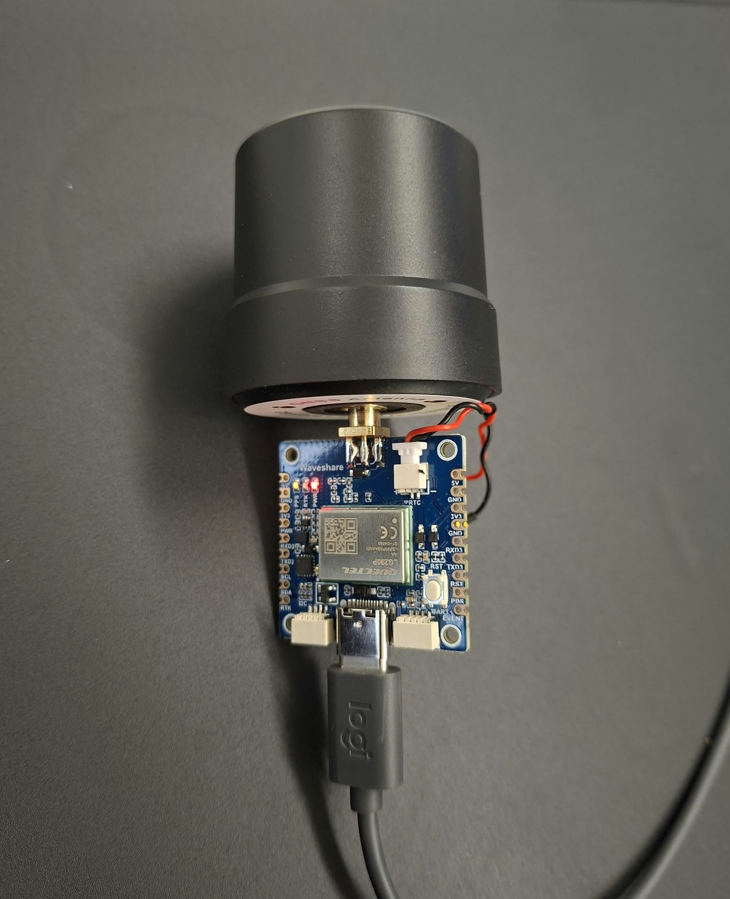
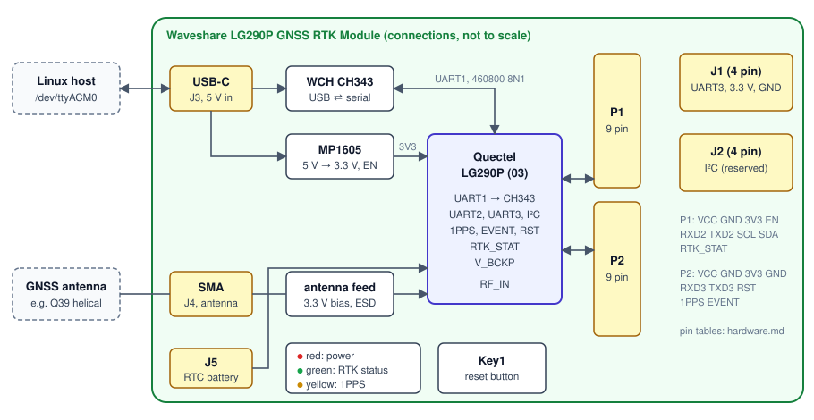

# lg290p-rtk

[](https://github.com/DennisRathgeb/lg290p-rtk/actions/workflows/ci.yml)
[](https://github.com/DennisRathgeb/lg290p-rtk/releases)
[](LICENSE)

**Linux driver, daemon and tools that turn the Quectel LG290P quad-band GNSS receiver into a
dependable centimetre-level RTK position source.**

<p align="center"></p>

The LG290P is the cheapest quad-band RTK receiver available, but on Linux nothing drives it:
gpsd treats it as generic NMEA and cannot configure it, and the vendor tools are Windows or
Arduino only. `lg290p-rtk` provides:

- **the `lgrtk` library** (C++20): an explicit state machine that configures the receiver,
  survives unplugging and resets, and delivers one `Fix` per epoch with RTK status, 1-sigma
  errors and timestamps;
- **the `lgrtkd` daemon**, which serves the receiver to every program on the machine over the
  **gpsd protocol** (`cgps`, QGIS, Python `gps`), plus a raw byte tap and a chrony time source;
- **the `lgrtk` command-line tool** to probe, watch, configure and reset the receiver;
- **NTRIP** corrections and **PROJ** projection to national grids (e.g. Swiss LV95 + LHN95).

## Contents

- [Features](#features)
- [Hardware](#hardware)
- [Quick start](#quick-start)
- [Using the library](#using-the-library)
- [Running the daemon](#running-the-daemon)
- [Command-line tool](#command-line-tool)
- [Documentation](#documentation)
- [Development](#development)
- [Status](#status)

## Features

| | |
|---|---|
| **Knows the receiver** | typed builders for the `$PQTM` command set, checked against Quectel's protocol specification; firmware and baud detection; the configuration is read back and only differences are written, so the flash is not worn and the receiver resets only when needed |
| **Never lies about freshness** | every fix carries the receiver's UTC and the host arrival time; the driver state and the age of the latest fix are always available; stale bytes the USB bridge replays after opening are discarded |
| **Recovers by itself** | unplug, replug, receiver reboot, silence: each transition is reported and streaming resumes without a restart |
| **RTK end to end** | NTRIP v1/v2 client with GGA upload for VRS casters; corrections injected over the same USB port without splitting an RTCM frame |
| **Frames done right** | fixes are tagged autonomous or corrected, and projection refuses a fix whose frame has not been declared, so a 0.8 m frame mix-up cannot happen silently |
| **Fast** | no allocation on the read → frame → parse → callback path; projection in microseconds |
| **Tested without hardware** | a simulated LG290P on a pseudo-terminal and a fake NTRIP caster; CI with ASan/UBSan and ThreadSanitizer |

## Hardware

| | |
|---|---|
| Receiver | Quectel **LG290P (03)**: GPS, GLONASS, Galileo, BeiDou, QZSS, NavIC; L1/L2/L5/E6; RTK 0.8 cm + 1 ppm; 10 Hz default, 20 Hz max |
| Reference board | **Waveshare LG290P GNSS RTK Module**: USB-C through a WCH CH343 (`/dev/ttyACM0`, 460800 baud), firmware `LG290P03AANR01A06S` |
| Also fits | SparkFun LG290P breakout, RTK Postcard, any LG290P on a UART |
| Host | Linux on x86-64 or aarch64; gcc ≥ 11 or clang ≥ 14; CMake ≥ 3.22 |



The [hardware guide](docs/hardware.md) covers the board's pinout, the messages and commands that
matter, the antenna, measured behaviour and troubleshooting.

## Quick start

```sh
# Arch:   pacman -S cmake ninja gtest proj
# Ubuntu: apt install cmake ninja-build libgtest-dev libproj-dev
git clone https://github.com/DennisRathgeb/lg290p-rtk && cd lg290p-rtk
make test                                 # build and run all tests; no hardware needed
./build/dev/lgrtk probe --seconds 5       # with the receiver plugged in
```

```text
port: /dev/ttyACM0 at 460800 baud
firmware: LG290P03AANR01A06S
bytes 10657, NMEA 330, RTCM 0, bad checksum 0, bad CRC 0
sentences: GGA 10.2 Hz GLL 10.2 Hz GSA 6.0 Hz GSV 18.9 Hz RMC 10.2 Hz VTG 10.2 Hz
GGA quality: none x51
last GGA: sats 0, hdop 99.99, diff age none
GST: not seen (enable: lgrtk config set msg-rate GST 1)
PQTMEPE: not seen
UTC span 5.0 s, backwards steps 0
```

This output was taken indoors, hence no fix: put the antenna under open sky.
`Permission denied`? Join the serial group (`uucp` on Arch, `dialout` on Debian/Ubuntu) and log
in again.

## Using the library

```cpp
#include <lgrtk/ntrip.h>
#include <lgrtk/projection.h>
#include <lgrtk/receiver.h>

lgrtk::ReceiverOptions opt;                         // /dev/ttyACM0, 460800, detects the rest
opt.config = lgrtk::lg290p::DefaultRoverConfig();   // 10 Hz, GGA/RMC/GST/EPE, RTK on
lgrtk::Lg290pReceiver rx(opt);

lgrtk::NtripClient ntrip({.host = "caster.example", .mountpoint = "MOUNT",
                          .user = "me", .password = pw}, rx);   // corrections into the receiver
std::string err;
// Declare the frame of corrected fixes; projecting picks the matching CRS.
auto lv95 = lgrtk::FixProjector::Create({.corrected_crs = "EPSG:4937"},   // e.g. swipos: CHTRS95
                                        "EPSG:2056+5729", err);          // LV95 + LHN95

rx.OnStatus([](const lgrtk::StatusEvent& e) { /* streaming, stale, reconnecting, ... */ });
rx.OnFix([&](const lgrtk::Fix& f) {
  ntrip.SetPosition(f);                                   // GGA for VRS mountpoints
  if (f.type != lgrtk::FixType::kRtkFixed) return;        // or weight by f.sigma_e/n/u_m
  double enh[3];
  lv95->Project(f, enh, err);                             // microseconds
});
rx.Start();
ntrip.Start();
```

Complete programs: [examples/print_fixes.cc](examples/print_fixes.cc) and
[examples/ntrip_rover.cc](examples/ntrip_rover.cc). `make docs` generates the API reference
([entry page](docs/api.md)).

Use it from CMake with `find_package(lgrtk)` after `make install`, or with `FetchContent`:

```cmake
FetchContent_Declare(lgrtk GIT_REPOSITORY https://github.com/DennisRathgeb/lg290p-rtk GIT_TAG v0.2.0)
FetchContent_MakeAvailable(lgrtk)
target_link_libraries(app PRIVATE lgrtk::lgrtk lgrtk::projection)
```

## Running the daemon

`lgrtkd` owns the receiver and serves it system-wide:

| Output | Default | For |
|---|---|---|
| gpsd JSON protocol | `127.0.0.1:2947` | `cgps`, `gpspipe`, QGIS, OpenCPN, Python `gps`; RTK fixed/float in TPV `status` |
| raw byte tap | off | loggers, RTKLIB `str2str`, post-processing |
| chrony SOCK refclock | off | system time from the receiver |
| control socket | `/run/lgrtkd/control.sock` | `lgrtk ctl status`, `reset`, `apply-default` |

```sh
cd packaging && makepkg -si               # Arch; other distributions: docs/daemon.md
sudo systemctl enable --now lgrtkd
lgrtk ctl status
cgps                                      # or any other gpsd client
```

It ships with a systemd unit (`Type=notify`, watchdog, hardened, own system user), a udev rule
(`/dev/lg290p0`, ModemManager kept away) and a strict TOML configuration. Installation,
configuration keys, the gpsd field mapping, chrony and troubleshooting are in
[docs/daemon.md](docs/daemon.md).

## Command-line tool

```text
lgrtk probe [--seconds N] [--raw FILE]     what the receiver sends (read-only)
lgrtk watch [--count N]                    one line per fix (read-only)
lgrtk status [--seconds N]                 state machine events and counters
lgrtk config get|set <key> ...             fix-rate, msg-rate, rtk, masks, decimals, constellations
lgrtk config apply-default                 the recommended rover configuration
lgrtk reset hot|warm|cold|soft|factory --yes
lgrtk base survey-in SECONDS ACC | fixed X Y Z | rover
lgrtk ntrip sourcetable HOST[:PORT]
lgrtk ntrip run --host H --mount M --user U --password-file F
lgrtk project --from EPSG:4937 --to EPSG:2056+5729 LAT LON H
lgrtk ctl status | reset KIND | apply-default    talks to a running lgrtkd
```

Global options: `--port PATH` (default `/dev/ttyACM0` or `$LGRTK_PORT`) and `--baud N`;
`lgrtk --help` shows everything.

## Documentation

| Document | Contents |
|---|---|
| [docs/hardware.md](docs/hardware.md) | the receiver and the Waveshare board: pinout, messages, commands, antenna, measurements, troubleshooting |
| [docs/architecture.md](docs/architecture.md) | layers, state machine, threading, fixes and frames, the daemon, testing |
| [docs/daemon.md](docs/daemon.md) | installing, configuring and operating `lgrtkd` |
| [docs/decisions.md](docs/decisions.md) | design decisions and their reasons |
| [CHANGELOG.md](CHANGELOG.md) | release notes |

| Path | Contents |
|---|---|
| `include/lgrtk/` | public headers |
| `src/` | the library; `src/daemon/` the daemon's internals (not installed) |
| `apps/` | the `lgrtk` CLI and the `lgrtkd` daemon |
| `examples/` | example programs |
| `tests/` | GoogleTest suite; `tests/sim/` the simulated receiver and fake caster |
| `packaging/` | systemd unit, udev rule, sysusers, example configuration, PKGBUILD |
| `tools/` | session recorder, lint helpers, git hooks |

## Development

```sh
make setup     # git hooks, build, tests
make check     # format, include guards, shellcheck, clang-tidy, tests, Doxygen: what CI runs
```

`make help` lists every target. Conventions and the pull-request workflow are in
[CONTRIBUTING.md](CONTRIBUTING.md).

## Status

| Version | |
|---|---|
| **v0.1.0** | library, CLI, NTRIP client, projection; verified on the reference board |
| **v0.2.0** | `lgrtkd` daemon, `lgrtk ctl`, systemd/udev/sysusers files, PKGBUILD; autonomous outdoor run on the reference board |
| next | RTK with a live caster on hardware, NTRIP over TLS, NTRIP server upload for an own base station, PPS time, a satellite callback in the library |

## Licence

MIT, see [LICENSE](LICENSE). Not affiliated with Quectel or Waveshare; product names belong to
their owners.
