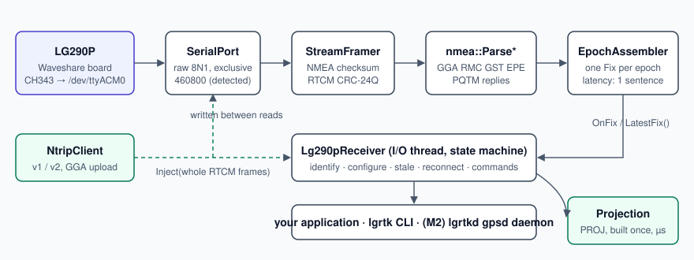
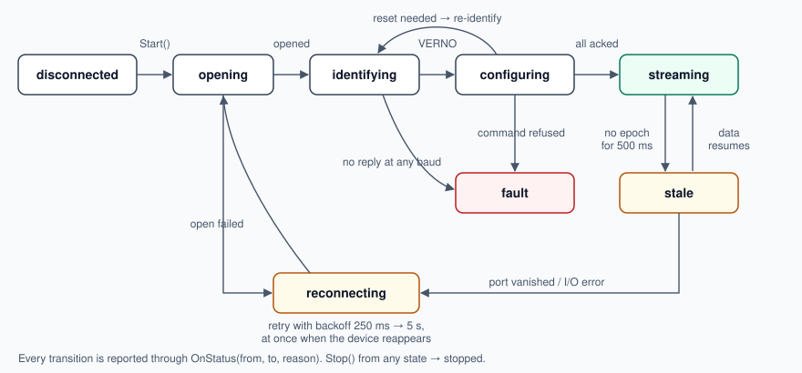

# lg290p-rtk

**A Linux toolkit that turns the Quectel LG290P quad-band GNSS receiver into a dependable
centimetre-level RTK position source.** C++20 library `lgrtk`, a command-line tool, NTRIP
corrections and fast coordinate projection, built around an explicit, tested state machine
that survives unplugging, receiver resets and wrong baud rates.

<!-- Photo: replace with docs/images/module-top.jpg once taken (see docs/images/README.md) -->
> 📷 *Photo of the Waveshare LG290P GNSS RTK Module with the Q39 helical antenna goes here.*

| | |
|---|---|
| Receiver | Quectel **LG290P (03)**: GPS, GLONASS, Galileo, BeiDou, QZSS, NavIC; L1/L2/L5/E6; 1040 channels; RTK 0.8 cm + 1 ppm; 10 Hz default, 20 Hz max |
| Tested board | **Waveshare LG290P GNSS RTK Module** (USB-C, WCH CH343 → `/dev/ttyACM0`, 460800 baud), firmware `LG290P03AANR01A06S` |
| Also fits | SparkFun LG290P breakout, RTK Postcard, any LG290P on a UART |
| Platform | Linux (x86-64, aarch64 / Jetson), gcc ≥ 11 or clang ≥ 14, CMake ≥ 3.22 |
| Licence | MIT |

## Why

The LG290P is the cheapest quad-band RTK receiver on the market, but on Linux there is no driver
for it: gpsd treats it as generic NMEA and cannot configure it, SparkFun's library is
Arduino-only, and every project ends up writing the same fragile serial loop. `lgrtk` is that
loop done properly, once:

- **It knows the receiver.** Typed builders for the `$PQTM` command set (checked against the
  Quectel protocol specification), firmware and baud detection, and a configuration that is read
  back and only *differences* are written, so the flash is not worn and a reset happens only when
  a setting needs one.
- **It never lies about freshness.** Every fix carries the receiver's UTC *and* the host
  monotonic arrival time; the driver state and the age of the latest fix are always available;
  stale bytes a USB bridge replays after reopening are discarded (found on the bench).
- **It recovers by itself.** Unplug, replug, receiver reboot, silence: the state machine reports
  each transition and goes back to streaming without a restart.
- **It does RTK end to end.** NTRIP v1/v2 client with GGA upload for VRS casters, corrections
  injected over the same USB port without ever splitting an RTCM frame, and PROJ-based
  projection to national grids (e.g. Swiss LV95 + LHN95 heights, verified against swisstopo
  REFRAME to 1 cm).

## Quick start

```sh
# dependencies (Arch: pacman -S cmake ninja gtest proj; Ubuntu: apt install cmake ninja-build libgtest-dev libproj-dev)
git clone https://github.com/DennisRathgeb/lg290p-rtk && cd lg290p-rtk
make test                 # builds with sanitizers and runs all tests, no hardware needed
./build/dev/lgrtk probe --seconds 30      # plug the receiver in first
```

```text
$ lgrtk probe --seconds 5          # real output, bench 2026-11-10, indoors
port: /dev/ttyACM0 at 460800 baud
firmware: LG290P03AANR01A06S
bytes 10657, NMEA 330, RTCM 0, bad checksum 0, bad CRC 0
sentences: GGA 10.2 Hz GLL 10.2 Hz GSA 6.0 Hz GSV 18.9 Hz RMC 10.2 Hz VTG 10.2 Hz
GGA quality: none x51
last GGA: sats 0, hdop 99.99, diff age none
GST: not seen (enable: lgrtk config set msg-rate GST 1)
PQTMEPE: not seen
UTC span 5.0 s, backwards steps 0
```

(Indoors, as above, expect no fix. Put the antenna outside.)

Permission denied? Add yourself to the serial group (`uucp` on Arch, `dialout` on Debian/Ubuntu)
and log in again. More in [docs/hardware.md](docs/hardware.md#troubleshooting).

## The library in 20 lines

```cpp
#include <lgrtk/ntrip.h>
#include <lgrtk/projection.h>
#include <lgrtk/receiver.h>

lgrtk::ReceiverOptions opt;                         // /dev/ttyACM0, 460800, detects the rest
opt.config = lgrtk::lg290p::DefaultRoverConfig();   // 10 Hz, GGA/RMC/GST/EPE, RTK auto
lgrtk::Lg290pReceiver rx(opt);

lgrtk::NtripClient ntrip({.host = "caster.example", .mountpoint = "MSM_GISGEO_LV95LHN95",
                          .user = "me", .password = pw}, rx);   // corrections into the receiver
std::string err;
auto lv95 = lgrtk::Projection::Create("EPSG:4937", "EPSG:2056+5729", err);  // built once

rx.OnStatus([](const lgrtk::StatusEvent& e) { /* streaming, stale, reconnecting, ... */ });
rx.OnFix([&](const lgrtk::Fix& f) {
  ntrip.SetPosition(f);                                   // GGA for VRS mountpoints
  if (f.type != lgrtk::FixType::kRtkFixed) return;        // or weight by f.sigma_e/n/u_m
  double enh[3];
  lv95->Forward(f.lat_deg, f.lon_deg, f.h_ell_m, enh);    // microseconds
});
rx.Start();
ntrip.Start();
```

Full programs: [examples/print_fixes.cc](examples/print_fixes.cc),
[examples/ntrip_rover.cc](examples/ntrip_rover.cc). Use it from CMake with
`find_package(lgrtk)` after `make install`, or with `FetchContent`:

```cmake
FetchContent_Declare(lgrtk GIT_REPOSITORY https://github.com/DennisRathgeb/lg290p-rtk GIT_TAG v0.1.0)
FetchContent_MakeAvailable(lgrtk)
target_link_libraries(app PRIVATE lgrtk::lgrtk lgrtk::projection)
```

## How it works



The I/O thread reads the port, the framer splits NMEA text from binary RTCM (checksums and
CRC-24Q verified, resynchronising after noise), the parsers decode GGA, RMC, GST, `$PQTMEPE` and
command replies, and the epoch assembler emits one `lgrtk::Fix` per epoch as soon as the
sentence pattern it learnt is complete: latency is one sentence, not one epoch. Nothing on that
path allocates.

### The state machine



| State | Meaning | Leaves when |
|---|---|---|
| `opening` | opening the tty exclusively (`TIOCEXCL`) | opened / failed |
| `identifying` | `$PQTMVERNO`; tries 460800, 921600, 115200, 230400, 9600 | firmware answers |
| `configuring` | reads every managed setting, writes differences, saves, resets only if needed | all acknowledged |
| `streaming` | epochs arrive | silence (→ `stale`) or port lost |
| `stale` | port open, no epoch for 500 ms | data resumes |
| `reconnecting` | port gone; backoff 250 ms → 5 s, immediately when the device reappears | port opens |
| `fault` | the receiver refused a command; `Status().last_error` names it | `Stop()` |

### What a fix contains

`lgrtk::Fix`: UTC time and date, host arrival time (`CLOCK_MONOTONIC`), latitude, longitude,
ellipsoidal height and the receiver's geoid separation, **fix type** (none, single, DGNSS,
RTK float, RTK fixed, …), **1-sigma east/north/up** from GST (or `$PQTMEPE`) with its source,
horizontal velocity, HDOP/PDOP, satellites, **correction age** and station id, and a **frame tag**:
`kAutonomous` (broadcast frame ≈ ITRF) or `kCorrected` (the frame of your corrections, e.g.
CHTRS95 with swipos). The receiver cannot know that frame; you declare it, so a 0.8 m frame mix-up
cannot happen silently.

## Command-line tool

```text
lgrtk probe [--seconds N] [--raw FILE]     what the receiver sends (read-only)
lgrtk watch [--count N]                    one line per fix (read-only)
lgrtk status [--seconds N]                 state machine events and counters
lgrtk config get|set <key> ...             fix-rate, msg-rate, rtk, masks, decimals, constellations
lgrtk config apply-default                 the recommended rover configuration
lgrtk reset hot|warm|cold|soft|factory --yes
lgrtk base survey-in SECONDS ACC | fixed X Y Z | rover
lgrtk ntrip sourcetable HOST[:PORT]
lgrtk ntrip run --host H --mount M --user U --password-file F
lgrtk project --from EPSG:4937 --to EPSG:2056+5729 LAT LON H
```

## Project layout

| Path | Contents |
|---|---|
| `include/lgrtk/` | public headers (documented, `make docs`) |
| `src/` | library |
| `apps/lgrtk/` | CLI |
| `tests/` | GoogleTest suite; `tests/sim/` simulated LG290P on a pseudo-terminal and a fake NTRIP caster |
| `examples/` | example programs |
| `docs/` | [hardware guide](docs/hardware.md), [design](docs/design.md), [decisions](docs/decisions.md), [plan](docs/plan.md), diagrams |

## Development

`make help` lists everything. `make setup` installs the git hook and runs the tests; `make check`
runs format check, include guards, clang-tidy, tests and Doxygen (all must be clean, as in CI).
See [CONTRIBUTING.md](CONTRIBUTING.md).

## Status and roadmap

- **v0.1.0** (this): library, CLI, NTRIP client, projection. Verified on the bench (identification,
  streaming, stale-byte handling); RTK with a real caster pending the login.
- **v0.2.0**: `lgrtkd` daemon speaking the gpsd JSON protocol (so `cgps`, QGIS and every gpsd
  client work), raw stream tap, chrony time source, udev rule, systemd unit, PKGBUILD, NTRIP over
  TLS, NTRIP server for an own base station.

## Licence

MIT, see [LICENSE](LICENSE). Not affiliated with Quectel or Waveshare; product names belong to
their owners.
