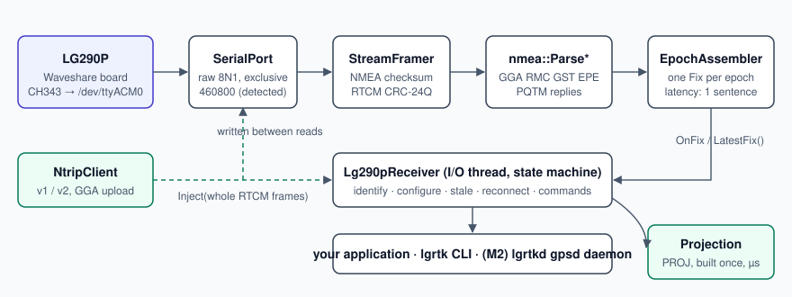
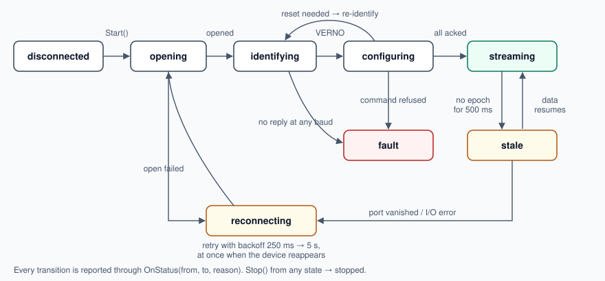

# Architecture

How `lgrtk` is built and why. For the receiver itself see [hardware.md](hardware.md); for the
daemon's operation see [daemon.md](daemon.md); for the reasoning behind individual choices see
[decisions.md](decisions.md).

## Goals

1. **A driver with an explicit state machine** that owns the serial port, survives unplugging and
   receiver resets without a process restart, and reports every state change.
2. **The receiver's command set as typed functions**: fix rate, per-message rates, RTK mode,
   constellations, masks, NMEA precision, base mode, resets, save to flash. Every write is
   acknowledged or reported.
3. **A fast data path**: one normalised `Fix` per epoch (10 Hz default, 20 Hz max), delivered by
   callback with no allocation after start, plus a snapshot for pollers.
4. **RTK end to end**: an NTRIP v1/v2 client that streams corrections into the receiver, sends GGA
   to VRS casters and reconnects by itself.
5. **Projection** to any CRS, built once and microseconds per point.
6. **System integration**: a daemon speaking the gpsd protocol, a raw byte tap, a chrony time
   source, systemd and udev files.

## Anti-goals

Things that would make it a failure even if it "works":

- **Stale data presented as fresh.** Every fix carries its arrival time; the driver state and the
  age of the latest fix are always available.
- **Writing the receiver's flash on every start.** The configuration is read back and only
  differences are written; save and reset happen only when something changed (D19).
- **Blocking or allocating on the hot path**, which would make the library unusable inside
  real-time threads.
- **Silent frame mix-ups.** Corrected and autonomous positions live in different frames (about
  0.8 m apart in Switzerland); fixes are tagged and projections refuse undeclared frames (D7, D20).

Out of scope: a kernel driver (D1), a GUI, firmware flashing (D15), Windows and macOS.

## Layers



| Component | Header | Responsibility |
|---|---|---|
| `SerialPort` | `serial.h` | opens a tty exclusively, raw 8N1, non-blocking writes |
| `StreamFramer` | `framer.h` | splits the byte stream into NMEA sentences (checksum) and RTCM3 frames (CRC-24Q); resynchronises after noise |
| `nmea::Parse*` | `nmea.h` | GGA, RMC, GST, GSA, GSV, VTG, ZDA, `$PQTMEPE`, `$PQTMVERNO`, `$PQTMSVINSTATUS`, command replies; zero allocation |
| `EpochAssembler` | `epoch.h` | groups the sentences of one UTC epoch into a `Fix`; learns the sentence pattern and emits as soon as it is complete |
| `lg290p::` | `lg290p.h` | builds checksummed `$PQTM` commands, matches replies, plans a configuration change (`PlanConfig`) |
| `Lg290pReceiver` | `receiver.h` | the state machine on its own I/O thread; callbacks `OnFix`, `OnStatus`, `OnNmea`, `OnRtcm`, `OnRaw`; `Inject()` for corrections |
| `NtripClient` | `ntrip.h` | NTRIP v1/v2 (chunked), GGA upload, backoff, stall detection; writes into any `CorrectionSink` |
| `Projection`, `FixProjector` | `projection.h` | PROJ transformation built once; picks the CRS that matches a fix's frame |
| `LocalFrame` | `local_frame.h` | tangent-plane ENU around an origin, without PROJ |

Only `Projection` depends on anything beyond the standard library (PROJ, optional: D12, D13).

## Receiver state machine



| State | Meaning | Leaves when |
|---|---|---|
| `kDisconnected` | not started | `Start()` |
| `kOpening` | opening the tty exclusively (`TIOCEXCL`), discarding stale bytes for 150 ms (D18) | opened / failed |
| `kIdentifying` | `$PQTMVERNO`; tries the configured baud, then 460800, 921600, 115200, 230400, 9600 | the firmware answers |
| `kConfiguring` | reads every managed setting, writes differences, saves, resets only if needed | all acknowledged |
| `kStreaming` | epochs arrive | silence (→ `kStale`) or port lost |
| `kStale` | port open, no epoch for 3 epoch periods, at least 500 ms (D21) | data resumes |
| `kReconnecting` | port gone; backoff 250 ms → 5 s, immediately when the device reappears | port opens |
| `kFault` | the receiver refused a command; `Status().last_error` names it | `Stop()` |
| `kStopped` | `Stop()` was called | — |

Every transition produces a `StatusEvent {from, to, reason}`. A receiver that resets on its own
(its UTC jumps back) is identified and configured again, so settings that were not
saved are re-applied.

The NTRIP client has its own small machine: `kIdle → kConnecting → kStreaming ⇄ kStalled →
kBackoff → kConnecting`, plus `kAuthFailed` (HTTP 401: stop, do not hammer the caster) and
`kNoPosition` (a VRS mountpoint needs a GGA and there is no fix yet).

## Threading

- One I/O thread per receiver. It reads with a 100 ms timeout, so `Stop()` returns quickly, and
  writes queued commands and corrections between reads, never splitting an RTCM frame and never
  more than 4 KiB per iteration, so writing cannot starve reading.
- Callbacks run on the I/O thread and must be short. `Snapshot()` returns the latest fix, its age
  and the driver state under one lock, for code that polls instead.
- `NtripClient` has its own thread and only calls `CorrectionSink::Inject()`, which queues.

## Fixes and frames

A `Fix` holds UTC time and date, the host arrival time (`CLOCK_MONOTONIC`), latitude, longitude,
ellipsoidal height and geoid separation, fix type, per-axis 1-sigma (from GST, else `$PQTMEPE`,
with its source), velocity, DOPs, satellites, correction age and station, and a frame tag:

- `kAutonomous`: the broadcast frame (≈ ITRF of the current epoch).
- `kCorrected`: the frame of *your* corrections, e.g. CHTRS95 for swipos. Only while RTCM injected
  through `lgrtk` reaches the receiver; SBAS and PPP solutions stay autonomous (D20).

The receiver cannot know the frame of the corrections, so the application declares it in
`FixProjector`, which then refuses fixes whose frame has no declared CRS.

## The daemon

```text
              ┌──────────────── lgrtkd ─────────────────┐
/dev/lg290p0 ─┤ Lg290pReceiver ──callbacks──► event loop ├─► gpsd clients (TCP 2947)
              │        ▲                     (1 thread)  ├─► raw tap clients
NTRIP caster ─┤ NtripClient ┘ corrections                ├─► chrony (unix datagram)
              │                                          ├─◄ lgrtk ctl (unix socket)
              └──────────────────────────────────────────┘
```

`lgrtkd` links the library (`src/daemon/` is an internal static library, `lgrtkd_core`). The
receiver and NTRIP threads only post work to a single `poll()` event loop, which owns every
socket: no locks around client state, and a client that stops reading is dropped when its
256 KiB buffer fills instead of slowing anyone else (D24).

| Module | Responsibility |
|---|---|
| `EventLoop`, `ClientSet` | `poll()` loop, timers, cross-thread `Post()` through an eventfd; per-client output buffers with the cap |
| `GpsdServer` | gpsd JSON protocol subset (D25) over TCP |
| `RawTap` | the untouched receiver bytes over TCP |
| `ChronySock` | chrony SOCK refclock samples (D26) |
| `ControlServer` | one JSON object per line on a Unix socket (D27) |
| `Daemon` | wires the receiver and NTRIP client to the outputs; SIGTERM through a signalfd; `apply-default` and unplug handling |
| `ParseConfig` | strict TOML: unknown keys and wrong types are errors |
| `SdNotify` | the systemd notification protocol (D28) |

## Testing

- Unit tests need no hardware: framer (partial reads, noise, interleaved NMEA/RTCM, CRC errors),
  parsers (protocol-spec examples and captured lines), epoch assembler, command builders and the
  configuration planner, projection against swisstopo reference points.
- Integration tests run the real state machine against a **simulated LG290P** on a
  pseudo-terminal (`tests/sim/`): it answers `$PQTM` commands, can refuse settings, reset, or be
  unplugged and replugged. A **fake NTRIP caster** covers 200, 401, chunked transfer and drops.
- `tests/daemon_test.sh` runs `lgrtkd` end to end against the simulator: gpsd client, raw tap,
  `lgrtk ctl`, unplug/replug, SIGTERM.
- CI builds with gcc 11 (Ubuntu 22.04), gcc and clang (Ubuntu 24.04), with ASan/UBSan and a
  ThreadSanitizer job, plus clang-format, clang-tidy, include guards and Doxygen.
- Behaviour found on real hardware is recorded in [hardware.md](hardware.md) and pinned by a test
  or a simulator case.
